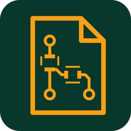

<p align="center">
  
</p>

# KiLog

A KiCad 9/10 PCB Editor plugin for recording live board edits, replaying JSON
logs, exporting selected components, and applying copper-zone and fanout helpers.
It communicates with the active editor through KiCad's IPC API.

## Installation

Copy this repository to the KiCad plugin directory:

- Windows: `%USERPROFILE%\Documents\KiCad\<version>\plugins\KiLog`
- macOS: `~/Documents/KiCad/<version>/plugins/KiLog`
- Linux: `~/.local/share/KiCad/<version>/plugins/KiLog`

In PCB Editor, enable the IPC API under **Preferences > Plugins**, then reload
plugins or restart PCB Editor. Open a board before launching KiLog.

## Usage

- **Record** — Set the Log prefix and start recording. Back/Next and the progress
  bar preview recorded states; Reset continues from the preview and discards later
  steps. Stop accepts the current position and writes `<prefix>.json`; Mark saves
  a numbered PCB copy beside the board, such as `ref_000.kicad_pcb`.
  Recording stays in memory until Stop; closing KiLog does not save it.
- **Replay** — Load a KiLog JSON file, seek or play at `0.25×`–`4×` speed, and
  mark PCB copies. Continue recording resumes at the current step and discards
  later steps. Playback edits are undoable and are not saved automatically.
- **Trace** — Toggle component references or select footprints in KiCad;
  selection stays synchronized. Mark exports the current selected footprints and
  direct copper paths between them, including unsaved edits, while removing other
  footprints and ordinary copper zones. Locked footprints are hidden but always
  included. The current board and recording history stay unchanged.
  A path through a third footprint's copper pad is not a direct connection,
  even when the trace is continuous. For A–C–B, selecting only A and B removes
  that path; selecting C too can retain the direct A–C and C–B connections.
  Exports go to the current board directory. Mark saves `<board>_001.kicad_pcb`,
  `<board>_002.kicad_pcb`, and so on, continuing after the largest existing number
  for that board in its directory. Existing files are kept; failed exports
  do not consume a number. Locked-only exports use the same numbering.
- **Skill** — GNDfill creates and fills zones on `F.Cu`, `B.Cu`, or both, with
  separate ground regions and magnetic-body keepouts. Review the resulting copper.
  Fanout routes matching SMD pads to through vias using the entered net, fallback
  trace width, via diameter, and drill. Both helpers use undoable commits.

**Starting a recording or loading a replay restores the saved PCB and discards
unsaved edits. Save unrelated work first; replay requires the board referenced
by the log.** Replacing an existing recording log requires confirmation.

Recording follows observed board states, so edits between polls may share a step.
Native Ctrl+Z remains under KiCad's control; returning to an earlier recorded
state rewinds the in-memory history.

## Development

Requires Python 3.10 or newer.

```powershell
python -m venv .venv
.\.venv\Scripts\python.exe -m pip install -r requirements-dev.txt
.\.venv\Scripts\python.exe -m pytest -q
```

See [AGENTS.md](AGENTS.md) for project development rules,
[DESIGN.md](DESIGN.md) for UI style and interaction conventions,
[the log schema](kilog/schemas/operation-log-v1.schema.json) for the JSON format,
and [CHANGELOG.md](CHANGELOG.md) for release history.
